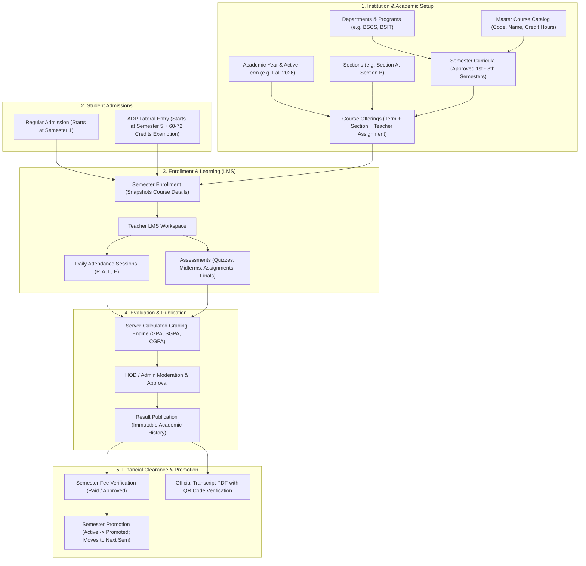

# 🎓 University Management & Student Information System (UMS / SIS / LMS)

[](https://laravel.com)
[](https://php.net)
[](https://tailwindcss.com)
[](https://getbootstrap.com)
[](https://vitejs.dev)
[](https://laravel.com/docs/reverb)
[]()

A comprehensive, enterprise-ready **University Management System (UMS)**, **Student Information System (SIS)**, and **Learning Management System (LMS)** built with Laravel 12.

The platform manages the complete academic lifecycle: institutional hierarchy setup, curriculum design, student admissions (including **ADP Lateral Entry** for 5th-semester transfers), course offerings, teacher assignments, daily attendance, assessment grading, flexible SGPA/CGPA result compilation, fee verification, semester promotion, and official PDF transcript generation with QR verification.

---

## 📌 Table of Contents

- [1. Technology Stack & Required Versions](#1-technology-stack--required-versions)
- [2. System Flow & Architecture (End-to-End Walkthrough)](#2-system-flow--architecture-end-to-end-walkthrough)
    - [Architecture & Information Flow Diagram](#architecture--information-flow-diagram)
    - [Phase-by-Phase Operational Workflow](#phase-by-phase-operational-workflow)
- [3. Key Modules & Portals](#3-key-modules--portals)
    - [Admin & Academic Setup](#a-admin--academic-setup-portal)
    - [Teacher LMS & Workspace](#b-teacher-lms--workspace)
    - [Student Portal](#c-student-portal)
    - [ADP / 5th-Semester Lateral Entry System](#d-adp--5th-semester-lateral-entry-system)
    - [Dynamic Filtering & Row Serialization](#e-dynamic-filtering--row-serialization)
- [4. Local Installation & Setup Guide (Laragon / Windows)](#4-local-installation--setup-guide-laragon--windows)
- [5. Demo Credentials](#5-demo-credentials)
- [6. Automated Testing](#6-automated-testing)
- [7. Directory Structure](#7-directory-structure)
- [8. License & Credits](#8-license--credits)

---

## 1. Technology Stack & Required Versions

To run this application locally, ensure your environment meets or exceeds the following versions:

| Component                 | Required Version                 | Local Tested Version       | Notes / Purpose                                    |
| ------------------------- | -------------------------------- | -------------------------- | -------------------------------------------------- |
| **PHP**                   | `^8.2.0`                         | `8.2.28 (NTS x64)`         | Modern PHP features, types, match statements       |
| **Local Server**          | **Laragon** (Recommended)        | `Laragon Full 6.x`         | Includes Apache/Nginx, MySQL, PHP, SSL             |
| **Framework**             | **Laravel 12** (`^12.0`)         | `12.x`                     | Modern backend routing, Eloquent ORM, Gates        |
| **Node.js**               | `v20.x` or `v24.x`               | `v24.13.0`                 | Asset compilation runtime                          |
| **NPM**                   | `v10.x` or `v11.x`               | `11.6.2`                   | Node package manager                               |
| **Composer**              | `v2.x`                           | `2.9.3`                    | PHP dependency manager                             |
| **Database**              | MySQL `8.0+` / MariaDB `10.4+`   | `MySQL 8.0` on port `3306` | Default DB: `dv_task_1` (SQLite for tests)         |
| **Build Tool**            | **Vite** (`^7.0.7`)              | `7.0.7`                    | Blazing-fast frontend bundler                      |
| **CSS Framework 1**       | **Tailwind CSS** (`^4.0.0`)      | `4.0.0`                    | Powered by `@tailwindcss/vite`                     |
| **CSS Framework 2**       | **Bootstrap** (`^5.2.3`)         | `5.2.3`                    | Admin & student UI components + Bootstrap Icons    |
| **WebSockets**            | **Laravel Reverb** (`^1.12`)     | `1.12.x`                   | Native high-performance WebSocket server (`:8080`) |
| **Realtime Client**       | `laravel-echo` & `pusher-js`     | `Echo 2.6.1`, `Pusher 8.6` | Client-side event listening                        |
| **PDF Generation**        | `barryvdh/laravel-dompdf`        | `^3.1`                     | Official transcripts & result card generation      |
| **QR Code Engine**        | `simplesoftwareio/simple-qrcode` | Latest                     | Security verification QR codes on PDF documents    |
| **Access Control (RBAC)** | `spatie/laravel-permission`      | `^6.25`                    | Roles, permissions, guards, and policy gates       |

---

## 2. System Flow & Architecture (End-to-End Walkthrough)

The project is architected around a strict **Semester-based Academic Progression Lifecycle**. Data flows sequentially from institutional definition to student graduation.

### Architecture & Information Flow Diagram



---

### Phase-by-Phase Operational Workflow

#### Phase 1: Institutional & Curriculum Setup (Admin)

1. **Departments & Programs:** Admin defines Departments (e.g., Computer Science, Management Sciences) and Degree Programs (e.g., BSCS 4-Year, BSIT 4-Year).
2. **Sections:** Sections are mapped to departments (e.g., Section A, Section B).
3. **Course Catalog:** Courses are added with standard codes, titles, credit hours, and default assessment breakdown schemes.
4. **Semester Curriculum:** For each Program and Semester (Semesters 1 through 8), Admin approves the exact mandatory and elective courses.
5. **Course Offerings:** For each active Term (e.g., Fall-2026), Course Offerings are created for each section, assigning one or more qualified Teachers.

#### Phase 2: Student Admission (Regular vs. ADP Lateral Entry)

- **Mode A: Regular Admission:**
    - Student enters the university at **Semester 1**.
    - Follows the standard 8-semester (4-year) degree roadmap.
- **Mode B: ADP Lateral Entry (5th Semester Transfer):**
    - Students holding an Associate Degree (ADP / 2-Year Degree) enter directly into **Semester 5**.
    - The system automatically grants **Credit Transfer / Advanced Standing Exemptions** (60 to 72 credit hours for Semesters 1 to 4) marked as `EX`.
    - Exempted credits do not calculate into numeric CGPA, protecting the student's standing while meeting graduation credit thresholds.
    - In Semester 5, ADP students join regular students in the **exact same Course Offerings, Sections, and Teacher LMS**.

#### Phase 3: Student Semester Enrollment

1. Admin opens an enrollment for a student in the active academic term and target semester.
2. The approved curriculum automatically populates mandatory courses and available electives.
3. The system stores **immutable course snapshots** (course code, title, credit hours, and assessment breakdown) inside `student_enrollment_courses` so future catalog edits never corrupt historical student records.

#### Phase 4: Teacher LMS & Teaching Workspace

1. Teachers log in to their dedicated **Teacher Panel** (`/teacher/workspace`).
2. Teachers can only see Course Offerings explicitly assigned to them.
3. **Attendance Module:** Teachers record lecture/lab attendance sessions (`Present`, `Absent`, `Late`, `Excused`). Attendance percentage updates automatically.
4. **Assessment & LMS:** Teachers create MCQ Quizzes, Midterms, Assignments, and Finals. Marks are strictly validated against maximum allowed limits.
5. Teachers upload lecture slides/materials and broadcast announcements directly to students.

#### Phase 5: Result Compilation, Moderation & Publishing

1. Teacher submits course marks when assessments and attendance are finalized.
2. The **Academic Grading Engine** calculates:
    - Sessional / Attendance component marks.
    - Total Course Percentage and Letter Grade (A, B, C, F) using the 4.0 GPA scale.
    - Course Grade Points, Status (`Pass` or `Fail`).
    - Weighted Semester GPA (SGPA) and Cumulative GPA (CGPA).
3. Academic Admin / HOD reviews the moderation sheet and publishes the result.
4. Once published, the semester record is locked and visible on the Student Portal.

#### Phase 6: Financial Clearance & Semester Promotion

1. **Fee Verification Rule:** A student cannot be promoted to the next semester unless their current semester fee is verified and approved by the Accounts/Admin department.
2. **Academic Progression Rule:** Promotion requires a published passing result (or permissible backlog policy).
3. Upon promotion:
    - The current enrollment status transitions from `active` to `promoted`.
    - A new enrollment is created for Semester $N+1$.
    - Any failed courses carry over as repeat courses.

#### Phase 7: Student Portal & Verification

1. Students log in to `/student/portal` to view attendance summaries, registered courses, class materials, quiz results, and notifications.
2. Students can generate and download their **Official Semester Result Card / Transcript PDF**.
3. Transcripts feature an **Embedded Verification QR Code** resolving to `/verify/document/{type}/{hash}` and a dedicated **Advanced Standing Box** for ADP Lateral students.

---

## 3. Key Modules & Portals

### A. Admin & Academic Setup Portal

- **Dashboard:** Real-time KPI counters (Students, Teachers, Active Enrollments, Departments).
- **Academic Setup:** Academic Calendars, Academic Years, Terms, Programs, Curricula, and Course Offerings.
- **Fee Management:** Vouchers, payments, and promotional financial clearance.
- **Access Control (RBAC):** Granular permissions and role assignments (Super Admin, Academic Admin, HOD, Teacher, Student).

### B. Teacher LMS & Workspace

- **Dedicated Route:** `/teacher/workspace` (isolated from admin endpoints).
- **Interactive Class Roster:** Student list with enrollment status and photos.
- **Session Attendance:** Quick attendance toggle with date/time logs.
- **Assessment Management:** Interactive MCQ quizzes with auto-grading, assignment submissions, and midterm/final mark entry.
- **Course Materials:** Secure file uploads (PDFs, PPTs, notes) for enrolled students.

### C. Student Portal

- **Dedicated Route:** `/student/portal`.
- **Real-time Overview:** Active semester, registered courses, attendance rates, pending fees, and announcements.
- **LMS Access:** View teacher materials and submit quiz responses.
- **Academic History:** Comprehensive record of all past semesters, SGPA, CGPA, and official PDF download.

### D. ADP / 5th-Semester Lateral Entry System

- Specifically designed for Pakistani / HEC-style Associate Degree (ADP) transfers:
    - Dropdown selector: `Regular`, `ADP Lateral Entry (Semester 5)`, or `Migration/Transfer`.
    - Pre-fills Semester 5 as the starting semester.
    - Transcript clearly reflects transferred credits without penalizing CGPA.
    - Seamless shared classes with regular 4-year BS students.

### E. Dynamic Filtering & Row Serialization

- **Instant Multi-Criteria Filters:**
    - Live search by name, email, phone, registration number, department, semester, and admission type.
    - Real-time select dropdowns and clickable quick-filter pills with live counts.
- **Dynamic Row Serialization (`#` Column):**
    - All lists (Students, Teachers, Enrollments, Courses, Sections) feature a 1-based sequential number column.
    - Recalculates dynamically (`1, 2, 3...`) whenever search or filters are applied, preventing fragmented database ID display.

---

## 4. Local Installation & Setup Guide (Laragon / Windows)

Follow these steps to set up the project on your local machine using **Laragon**:

### Step 1: Clone the Repository

```bash
git clone https://github.com/your-username/DV_Task_1.git
cd DV_Task_1
```

### Step 2: Configure Environment Variables

Copy `.env.example` to `.env`:

```bash
cp .env.example .env
```

Ensure the database and Reverb credentials in `.env` match your local Laragon setup:

```env
APP_NAME="University Management System"
APP_ENV=local
APP_KEY=
APP_DEBUG=true
APP_TIMEZONE=Asia/Karachi
APP_URL=http://localhost:8001

DB_CONNECTION=mysql
DB_HOST=127.0.0.1
DB_PORT=3306
DB_DATABASE=dv_task_1
DB_USERNAME=root
DB_PASSWORD=

BROADCAST_CONNECTION=reverb

REVERB_APP_ID=local-university
REVERB_APP_KEY=local-university-key
REVERB_APP_SECRET=local-university-secret
REVERB_HOST="localhost"
REVERB_PORT=8080
REVERB_SCHEME=http

VITE_REVERB_APP_KEY="${REVERB_APP_KEY}"
VITE_REVERB_HOST="${REVERB_HOST}"
VITE_REVERB_PORT="${REVERB_PORT}"
VITE_REVERB_SCHEME="${REVERB_SCHEME}"
```

### Step 3: Install PHP Dependencies

```bash
composer install
```

### Step 4: Generate Application Key

```bash
php artisan key:generate
```

### Step 5: Database Setup & Migrations

1. In Laragon, click **Start All** to launch MySQL and Apache/Nginx.
2. Create a new MySQL database named `dv_task_1` (via HeidiSQL or phpMyAdmin).
3. Run the migrations and seeders:

```bash
php artisan migrate --seed
```

_(Optional) Seed the complete Semester 5 & ADP Lateral Entry demo environment:_

```bash
php artisan db:seed --class=Semester5DemoSeeder
```

### Step 6: Create Storage Symlink

```bash
php artisan storage:link
```

### Step 7: Install Frontend Dependencies & Build Assets

```bash
npm install
npm run build
```

_(Or keep `npm run dev` running for live asset reloading during development)._

### Step 8: Start Local Servers

Run the development server on port `8001`:

```bash
php artisan serve --port=8001
```

_(Optional for Realtime WebSockets):_

```bash
php artisan reverb:start
```

Visit the application in your browser at: **[http://localhost:8001](http://localhost:8001)**

---

## 5. Demo Credentials

The database seeders configure ready-to-test accounts for every role:

| Role                    | Name           | Email                        | Password        | Access Scope                                    |
| ----------------------- | -------------- | ---------------------------- | --------------- | ----------------------------------------------- |
| **Super Admin**         | Admin User     | `admin@gmail.com`            | `1234`          | Full access across all modules, settings & RBAC |
| **Teacher 1**           | Teacher Hamza  | `demo.teacher1@example.test` | `UniDemo@2026!` | Assigned to Programming & Computing Lab         |
| **Teacher 2**           | Teacher Ayesha | `demo.teacher2@example.test` | `UniDemo@2026!` | Assigned to Mathematics & Computing Lab         |
| **Regular Student**     | Student Dawood | `dawood@gmail.com`           | `1234`          | 4-Year BS Student (Semester 1 to 3 History)     |
| **ADP Lateral Student** | Zubair Ahmed   | `adp.student@gmail.com`      | `1234`          | 5th-Semester Direct Entry (60 Credits Exempted) |

---

## 6. Automated Testing

The codebase includes an extensive suite of **Unit and Feature Tests** validating academic flow, role authorization, result calculations, fee locks, and lateral entry integrity.

To execute the test suite:

```bash
php artisan test
```

### Test Suite Status:

```text
  Tests:    181 passed (1225 assertions)
  Duration: ~140s
  Status:   100% Passing (0 failures)
```

Core test coverage highlights:

- `LateralEntryTransferTest`: Validates ADP 5th-semester enrollment, credit exemptions, transcript PDF, and isolation.
- `AcademicSetupTest`: Verifies curriculum locks, duplicate protection, and offering constraints.
- `TeacherPanelTest`: Asserts scoped access to assigned offerings and strict data separation.
- `AcademicResultSubmissionValidationTest` & `AcademicResultCalculatorTest`: Confirms server-side grade calculation, fractional weights, and SGPA/CGPA integrity.
- `OperationalHardeningTest`: Validates anti-tampering, unauthorized access denials, and fee clearance locks.

---

## 7. Directory Structure

```text
DV_Task_1/
├── app/
│   ├── Http/
│   │   ├── Controllers/
│   │   │   ├── Academic/          # Programs, Terms, Curricula, Course Offerings
│   │   │   ├── Attendance/        # Attendance sessions & tracking
│   │   │   ├── Assessments/       # Quizzes, assignments, mark entries
│   │   │   ├── Enrollment/        # Semester enrollments & course selections
│   │   │   ├── Result/            # Grading engine, moderation, and publication
│   │   │   ├── Teaching/          # Teacher Workspace / LMS controllers
│   │   │   └── Documents/         # PDF Generation & QR verification
│   │   └── Middleware/            # Authentication & role checks
│   ├── Models/                    # Eloquent Models (Student, Teacher, Course, etc.)
│   └── Services/                  # Grading calculations, PDF services, workspaces
├── config/                        # Laravel configuration files
├── database/
│   ├── migrations/                # Database schemas & relationship definitions
│   └── seeders/                   # Initial data, roles, demo terms, and students
├── docs/                          # Detailed architecture guides and roadmaps
├── public/
│   ├── css/                       # Custom styles (admin-panel.css, etc.)
│   └── js/                        # Universal search & live filter scripts
├── resources/
│   └── views/                     # Blade views (Admin, Teachers, Students, Results)
├── routes/
│   ├── web.php                    # Core web routes
│   ├── teaching.php               # Teacher workspace routes
│   ├── student-portal.php         # Student portal routes
│   └── attendance.php             # Attendance tracking routes
└── tests/                         # 181 automated Feature and Unit tests
```

---

## 8. License & Credits

- Developed as part of the **DevVerx Learning Program**.
- Framework: [Laravel](https://laravel.com) (Created by Taylor Otwell).
- License: [MIT License](LICENSE).
